<!--
  SETUP: this file already uses the username VigneshDeekonda.
  Keep the assets/ folder and .github/workflows/snake.yml in the same repo.
  GIFs from gifcities.org can go into assets/ and be added with .
-->

<p align="center">
  
</p>

<h1 align="center">
  
</h1>

<p align="center"></p>

<p align="center"></p>

<p align="center">
  <b>i love backends</b> &nbsp;and&nbsp; <b>clean APIs</b> &nbsp;
</p>

<p align="center">
  
</p>

<p align="center"></p>

## 🎮 player 1

```text
+----------------------------------------------------------+
|  PLAYER 1  : VIGNESH                                     |
|  CLASS     : Python Backend Developer                    |
|  LEVEL     : Final-year B.Tech Computer Engineering      |
|  GUILD     : Terna Engineering College, Navi Mumbai      |
|  SPECIAL   : Minor in AI & ML                            |
|  ARENAS    : LeetCode | Codeforces | Codolio              |
|  QUEST     : Land a Python backend role                  |
|  STATUS    : Graduating 2027 - open to work              |
+----------------------------------------------------------+
```

## 🕹️ my stack

<p align="center">
  
  
  
  
  
  
  
  
  
  
  
  
</p>

<p align="center"></p>

## 💾 things i've built

| Project | What it is | Stack |
|---|---|---|
| 🛒 [**Cartify**](https://github.com/VigneshDeekonda/cartify) | E-commerce platform | Django |
| 💻 [**CodSync**](https://github.com/VigneshDeekonda/codsync) | Real-time collaborative coding platform | Node.js, Socket.IO |
| ✈️ [**Snaptrips**](https://github.com/VigneshDeekonda/snaptrips) | AI-powered travel planner | Python, AI |
| 🛡️ [**AI-ACDS**](https://github.com/VigneshDeekonda/ai-acds) | AI-powered autonomous cyber defence system | React, FastAPI |

## ⚔️ competitive coding arenas

<p align="center">
  <a href="https://leetcode.com/u/Vigneshdeekonda/"></a>
  <a href="https://codeforces.com/profile/VigneshDeekonda"></a>
  <a href="https://codolio.com/profile/vignesh_deekonda"></a>
</p>

<p align="center">
  <a href="https://leetcode.com/u/Vigneshdeekonda/">
    
  </a>
  <a href="https://codeforces.com/profile/VigneshDeekonda">
    
  </a>
</p>

<p align="center"></p>

## 🐍 snake is eating my contributions

<p align="center">
  <picture>
    <source media="(prefers-color-scheme: dark)" srcset="https://raw.githubusercontent.com/VigneshDeekonda/VigneshDeekonda/output/github-snake-dark.svg">
    
  </picture>
</p>

## 📡 find me

<p align="center">
  <a href="https://www.linkedin.com/in/vigneshdeekonda/"></a>
  <a href="mailto:vignesh.deekonda5002@gmail.com"></a>
  <a href="https://leetcode.com/u/Vigneshdeekonda/"></a>
  <a href="https://codeforces.com/profile/VigneshDeekonda"></a>
</p>

<p align="center"></p>

<p align="center">
  
</p>

<p align="center">
  
  
  
  
</p>

<p align="center">
  
</p>
